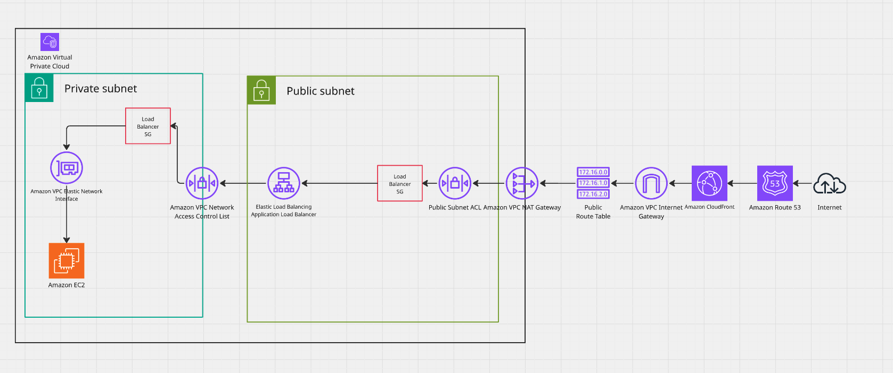

# Vulcao Backend

Spring Boot REST API powering the Vulcao platform. Runs on AWS EC2 behind an Application Load Balancer and CloudFront, backed by DynamoDB.

---

## Table of Contents

- [Architecture](#architecture)
- [Tech Stack](#tech-stack)
- [Project Structure](#project-structure)
- [Getting Started](#getting-started)
- [Configuration](#configuration)
- [Authentication](#authentication)
- [API Overview](#api-overview)
- [Database](#database)
- [Deployment](#deployment)
- [Infrastructure](#infrastructure)
- [Troubleshooting](#troubleshooting)

---

## Architecture



**Request flow, in words:**

1. The browser sends an HTTPS request to the CloudFront distribution.
2. CloudFront terminates TLS and forwards the request over HTTP to the Application Load Balancer, using the `/api/*` path pattern.
3. The ALB health-checks EC2 instances in the Auto Scaling Group and forwards the request to a healthy instance on port `8080`.
4. Spring Boot handles the request: Spring Security filters run first (JWT cookie validation, CORS), then the request reaches the relevant controller.
5. The controller calls a service, which reads/writes DynamoDB via the AWS SDK v2 Enhanced Client, authenticating with the EC2 instance's IAM role (no hardcoded credentials).
6. The response travels back through the same path to the browser.

**Why this shape:**
- **CloudFront in front of the ALB** gives free HTTPS (`*.cloudfront.net`) without owning a custom domain. All internal hops (CloudFront → ALB → EC2) are plain HTTP because they never leave AWS's private network.
- **Auto Scaling Group** means the backend can absorb traffic spikes and self-heal if an instance becomes unresponsive — unhealthy instances are automatically replaced.
- **IAM instance role** (not static access keys) means credentials are never stored on disk and rotate automatically.

---

## Tech Stack

| Layer | Technology |
|---|---|
| Language | Java 25 |
| Framework | Spring Boot 4.0.6 |
| Security | Spring Security (JWT, stateless sessions) |
| Database | Amazon DynamoDB (AWS SDK v2 Enhanced Client) |
| Web server | Embedded Tomcat |
| Build tool | Maven |
| Deployment | AWS CodeDeploy → EC2 Auto Scaling Group |
| Load balancing | AWS Application Load Balancer |
| CDN / TLS | Amazon CloudFront |
| Logs | AWS CloudWatch Logs |
| Remote access | AWS Systems Manager (SSM) |

---

## Project Structure

```
src/main/java/dev/hope/backend/
├── BackendApplication.java          # Entry point
├── Authentication/
│   ├── JwtCookieFilter.java         # Reads AUTH_TOKEN cookie, sets SecurityContext
│   └── JWTService.java              # Token generation/validation
├── Configuration/
│   ├── DynamoDbConfig.java          # DynamoDB client + enhanced client beans
│   ├── SecurityConfiguration.java   # Spring Security filter chain, public routes
│   └── CORSConfig.java              # CORS allowed origins/methods/headers
├── Models/
│   ├── User.java                    # @DynamoDbBean entity classes
│   └── Properties/                  # Enum-like value classes (Genres, Currency, etc.)
├── Repositories/
│   └── UserRepository.java          # DynamoDB table access
├── Services/
│   ├── AuthService.java             # Validation, registration/login logic
│   └── ...
└── RestControllers/
    ├── PrivateEndpoints/
    │   └── AuthController.java      # /api/v1/auth/**
    └── PublicEndpoints/
        └── ...                     # /api/v1/public/**

src/main/resources/
├── application.properties           # Shared config (all profiles)
├── application-dev.properties       # Local dev overrides (DynamoDB Local endpoint)
└── application-prod.properties      # Production overrides (usually empty — defaults apply)
```

---

## Getting Started

### Prerequisites

- Java 25 (JDK)
- Maven 3.9+
- Docker (for DynamoDB Local, optional but recommended for local dev)
- AWS CLI configured (`aws configure`) if you want to hit real AWS services locally

### Run locally against DynamoDB Local

```bash
# 1. Start DynamoDB Local
docker run -p 8000:8000 amazon/dynamodb-local

# 2. Create tables (one-time, or use a setup script)
aws dynamodb create-table \
  --table-name Users \
  --attribute-definitions AttributeName=id,AttributeType=S \
  --key-schema AttributeName=id,KeyType=HASH \
  --billing-mode PAY_PER_REQUEST \
  --endpoint-url http://localhost:8000

# 3. Run the app with the dev profile
./mvnw spring-boot:run -Dspring-boot.run.profiles=dev
```

The app starts on `http://localhost:8080`.

### Run locally against real AWS DynamoDB

```bash
# Make sure you've run `aws configure` with credentials that can access DynamoDB
./mvnw spring-boot:run -Dspring-boot.run.profiles=prod
```

With no `aws.dynamodb.endpoint` set, the SDK talks to the real regional DynamoDB endpoint using your local AWS credentials.

### Build a deployable JAR

```bash
./mvnw clean package -DskipTests
# Output: target/Backend-0.0.1-SNAPSHOT.jar
```

---

## Configuration

Configuration is split by Spring profile. **Never hardcode environment-specific values in code** — use `application-{profile}.properties` and `@Value` with defaults.

**`application.properties`** (shared):
```properties
spring.application.name=Backend
aws.dynamodb.region=eu-south-2
```

**`application-dev.properties`** (local development):
```properties
aws.dynamodb.endpoint=http://localhost:8000
```

**`application-prod.properties`** (production — intentionally minimal):
```properties
# No endpoint override -> SDK uses the real regional DynamoDB endpoint
# No static credentials -> SDK uses the EC2 instance's IAM role
```

The active profile is set via the JVM argument in the systemd service:
```
ExecStart=/usr/bin/java -jar /opt/vulcao-api/app.jar --spring.profiles.active=prod
```

### Environment-specific values, at a glance

| Setting | Dev | Prod |
|---|---|---|
| DynamoDB endpoint | `http://localhost:8000` | *(unset — regional endpoint)* |
| Credentials | Local AWS CLI profile | EC2 instance role (`DefaultCredentialsProvider`) |
| CORS allowed origins | `http://localhost:3000` | Frontend's CloudFront/production URL |

---

## Authentication

JWT-based, stored in an HTTP-only cookie (`AUTH_TOKEN`), validated on every request by `JwtCookieFilter`.

**Flow:**
1. `POST /api/v1/auth/user/login` — validates credentials, issues a signed JWT, sets it as an HTTP-only cookie.
2. Every subsequent request includes the cookie automatically (`credentials: "include"` on the frontend fetch).
3. `JwtCookieFilter` extracts the cookie, validates the token, and populates `SecurityContextHolder` if valid. Invalid/missing tokens are treated as anonymous — the filter never blocks the request itself; downstream authorization rules decide whether the route requires authentication.

**Public routes** (no authentication required) are explicitly whitelisted in `SecurityConfiguration`:
```java
.requestMatchers(
    "/api/v1/auth/employer/login",
    "/api/v1/auth/employer/register",
    "/api/v1/auth/staff/login",
    "/api/v1/auth/staff/register",
    "/api/v1/auth/user/register",
    "/api/v1/auth/user/login",
    "/api/v1/public/**"
).permitAll()
.anyRequest().authenticated()
```

Anything not in that list requires a valid JWT.

---

## API Overview

| Method | Endpoint | Auth required | Description |
|---|---|---|---|
| POST | `/api/v1/auth/user/register` | No | Register a new user |
| POST | `/api/v1/auth/user/login` | No | Log in, receive `AUTH_TOKEN` cookie |
| POST | `/api/v1/auth/employer/register` | No | Register a new employer |
| POST | `/api/v1/auth/employer/login` | No | Employer login |
| POST | `/api/v1/auth/staff/register` | No | Register staff account |
| POST | `/api/v1/auth/staff/login` | No | Staff login |
| GET | `/api/v1/user/get/my-profile` | Yes | Get the logged-in user's profile |
| GET | `/api/v1/public/**` | No | Public catalog/browse endpoints |

> Keep this table updated as endpoints are added. Consider generating this automatically with springdoc-openapi if the API grows.

### Error response shape

All error responses should return a JSON body — never an empty 400/500. Standard shape:

```json
{
  "error": "human-readable message",
  "details": { }
}
```

---

## Database

Backed by DynamoDB. See the full [DynamoDB reference document](./dynamodb-reference.md) for schema design, GSI rollout process, and query patterns.

**Tables currently in use:**
- `Users`
- `Employers`
- `Staffs`
- `Companies`
- `Products`, `Books`, `Movies`, `Music`, `TvShows` (catalog items)
- `Carts`, `CartItems`
- `AuthenticationData`

**Key principle**: tables are provisioned outside the application (via AWS CLI / Terraform / Console), not via runtime `createTable()` calls. Auto-creating tables at startup is a development convenience only — remove it before scaling to multiple environments.

---

## Deployment

Deployment is automated via **AWS CodeDeploy**.

```
git push → CI builds JAR → CodeDeploy deployment triggered → 
  new JAR copied to /opt/vulcao-api/app.jar on each ASG instance → 
  systemd restarts vulcao-api.service
```

**Manual deployment check:**

```bash
aws deploy list-deployments \
  --application-name vulcao-deployment \
  --deployment-group-name vulcao-deployment-dev-group \
  --region eu-south-2 \
  --max-items 5

aws deploy get-deployment \
  --deployment-id <id> \
  --region eu-south-2 \
  --query 'deploymentInfo.[status,createTime,errorInformation]'
```

**systemd service** (`/etc/systemd/system/vulcao-api.service`):
```ini
[Unit]
Description=vulcao-api
After=network.target

[Service]
User=springboot
WorkingDirectory=/opt/vulcao-api
ExecStart=/usr/bin/java -jar /opt/vulcao-api/app.jar --spring.profiles.active=prod
SuccessExitStatus=143
Restart=always
RestartSec=10
StandardOutput=append:/var/log/vulcao-api/application.log
StandardError=append:/var/log/vulcao-api/application.log

[Install]
WantedBy=multi-user.target
```

---

## Infrastructure

| Resource | Value |
|---|---|
| AWS Account | `500766169103` |
| Region | `eu-south-2` |
| Auto Scaling Group | `Vulcao-ASG` |
| ALB | `VULCA-ALB` |
| Target group | `Vulca-target-group-http` (HTTP:8080) |
| Instance IAM role | `VulcaoWebServerRole` |
| CodeDeploy app | `vulcao-deployment` |
| CloudFront distribution | `ESPECHW8A6GRU` |

### Auto Scaling

The ASG scales based on average CPU utilization (target tracking, 60%). Min/max bounds should reflect expected load and budget:

```bash
aws autoscaling describe-auto-scaling-groups \
  --auto-scaling-group-names Vulcao-ASG \
  --region eu-south-2 \
  --query 'AutoScalingGroups[0].[MinSize,MaxSize,DesiredCapacity]'
```

### IAM Permissions

The instance role (`VulcaoWebServerRole`) needs DynamoDB access, scoped to the tables the app actually uses — avoid `AmazonDynamoDBFullAccess` in production; prefer an explicit resource-scoped policy.

---

## Troubleshooting

### App won't start / crash loops

```bash
aws logs tail /aws/ec2/vulcao-api/application --region eu-south-2 --follow
```

Common causes:
- Empty `aws.dynamodb.endpoint` combined with an unconditional `endpointOverride()` call — remove the endpoint override in prod, or guard it with `if (endpoint != null && !endpoint.isBlank())`.
- Missing IAM permissions on the instance role.
- Misnamed properties file (check for macOS `application copy.properties` duplication artifacts).

### 502/504 from the ALB / target unhealthy

```bash
aws elbv2 describe-target-health \
  --target-group-arn <arn> --region eu-south-2 \
  --query 'TargetHealthDescriptions[].[Target.Id,TargetHealth.State,TargetHealth.Reason]'
```

Check, in order: target group protocol/port matches the app (`HTTP:8080`), security group allows the ALB's SG on that port, app is bound to `0.0.0.0` not `127.0.0.1`.

### Silent 400/500 with empty response body

Look for `ResponseEntity.status(...).build()` calls with no `.body(...)`. Add a JSON error body so the client (and you, debugging) can see what failed.

### Remote shell into an instance

```bash
aws ssm start-session --target <instance-id> --region eu-south-2
sudo tail -f /var/log/vulcao-api/application.log
```
